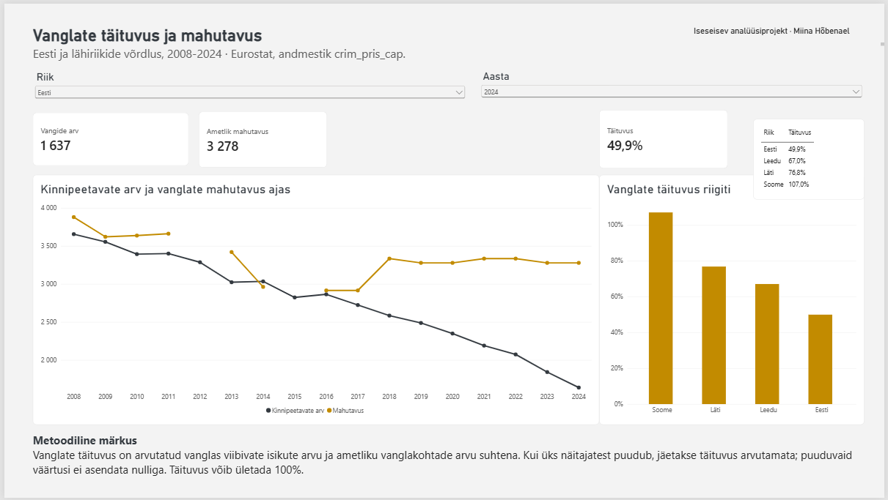

# Vanglate täituvuse ja mahutavuse analüüs

**Iseseisev analüüsiprojekt | Power Query · Power BI · DAX**

## Projekti eesmärk

Projekti eesmärk on analüüsida kinnipeetavate arvu, vanglate ametlikku mahutavust ja täituvust Eestis ning võrrelda tulemusi lähiriikide Läti, Leedu ja Soomega.

Fookuses on andmete ettevalmistamine Power Query abil, interaktiivse Power BI juhtpaneeli loomine ning näitajate korrektne tõlgendamine.

## Juhtpaneel

[Power BI juhtpaneeli fail](powerbi/Vanglate_täituvus_ja_mahutavus.pbix)

Juhtpaneel võimaldab:
- Vaadata kinnipeetavate arvu, vanglate ametlikku mahutavust ja täituvuse määra valitud riigis ning aastal.
- Jälgida kinnipeetavate arvu ja vanglate mahutavuse muutumist aastatel 2008–2024.
- Võrrelda Eesti, Läti, Leedu ja Soome vanglate täituvust.
- Tuvastada puuduvaid andmeid.

## Andmeallikas

**Allikas:** Eurostat, andmestik `crim_pris_cap`.

Andmed imporditi Power BI-sse Eurostati API kaudu, kasutades Power Query veebipäringut.

Andmestik sisaldab muuhulgas järgmisi näitajaid:

- `PRIS_ACT_CAP` – vanglas viibivate isikute arv.
- `PRIS_OFF_CAP` – vanglate ametlik mahutavus.

Analüüs hõlmab nelja riiki: Eesti, Läti, Leedu ja Soome. Ajalooline võrdlus hõlmab aastaid 2008–2024.

## Andmete töötlemine

Power Query abil teostati järgmised toimingud:

1. Andmete importimine Eurostati API-st.
2. Andmete filtreerimine riigi, näitaja ja mõõtühiku järgi.
3. Veergude andmetüüpide määramine.
4. Näitajate teisendamine pikast andmevormingust laia vormingusse (Pivot Column).
5. Vanglate täituvuse arvutamine.
6. Puuduvate väärtuste säilitamine ja kontrollimine.
7. Riigikoodide asendamine eestikeelsete riiginimedega.

Täituvuse määr arvutati järgmiselt:

**Täituvus = kinnipeetavate arv / ametlik mahutavus**

Kui kinnipeetavate arv või ametlik mahutavus puudub, jäetakse täituvus arvutamata. Puuduvaid väärtusi ei asendata nulliga.

## Power BI ja DAX

Power BI-s loodi DAX-mõõdikud järgmiste näitajate esitamiseks:

- Kinnipeetavate arv
- Ametlik mahutavus
- Täituvuse määr

Juhtpaneel sisaldab riigi- ja aastafiltreid, KPI-kaarte, ajaloolist joondiagrammi ning riikide võrdlusdiagrammi.

Visuaalide koostoimed on seadistatud nii, et aastafilter ei piira ajaloolist trendi ühe aastaga ning riigifilter ei eemalda teisi riike võrdlusdiagrammilt.

## Andmekvaliteet ja tõlgendamise piirangud

- Mõne riigi ja aasta kohta puuduvad ametliku mahutavuse andmed. Sellisel juhul ei saa täituvust arvutada.
- Vanglate täituvus võib ületada 100%, kui kinnipeetavate arv on ametlikust mahutavusest suurem.
- Riikide võrdlemisel tuleb arvestada võimalike erinevustega statistiliste näitajate määratlustes ja aruandluses.
- Vanglate täituvus ei ole iseseisev vanglateenistuse tulemuslikkuse näitaja.
- Tulemused põhinevad Eurostati avalikel statistilistel andmetel ega kujuta endast ametlikku hinnangut vanglateenistuse tegevusele.

## Projekti failid

- `powerbi/` – interaktiivne Power BI juhtpaneel (.pbix).
- `docs/` – juhtpaneeli ekraanipilt.
- `README.md` – projekti kirjeldus ja metoodika.

Power BI fail sisaldab Power Query teisendusi, andmemudelit, DAX-mõõdikuid ja visualiseeringuid.

Andmete värskendamiseks on vajalik juurdepääs Eurostati andmeallikale.

---

**Märkus:** Tegemist on iseseisva analüüsiprojektiga, mitte Vanglateenistuse ametliku analüüsi või väljaandega.
